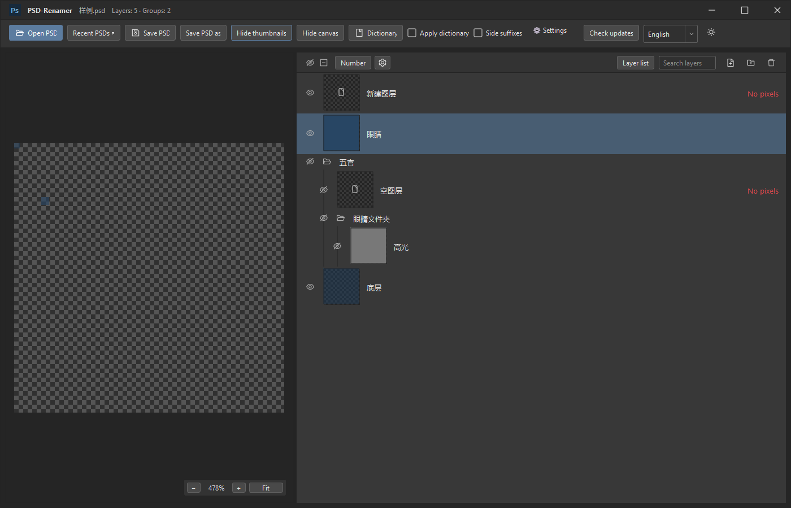
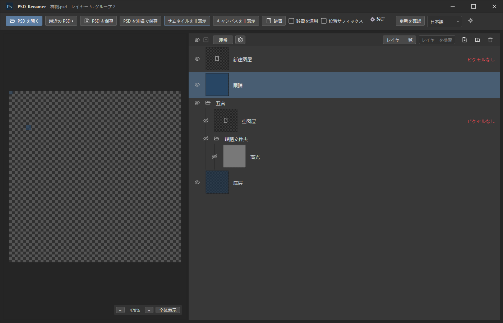

# PSD-Renamer

  

**[下载最新版 / Download latest](https://github.com/Miroirkk-arch/PSD-Renamer/releases/latest)** · [v1.3.0 Windows ZIP](https://github.com/Miroirkk-arch/PSD-Renamer/releases/download/v1.3.0/PSD-Renamer-v1.3.0-win-x64.zip)

Windows 64 位 · 中文／English／日本語 · 无需 Photoshop · 无需安装 Node.js 或 Qt  
Windows x64 · Chinese / English / Japanese UI · No Photoshop required · Bundled runtimes

截图使用测试文档。 / Screenshot uses a test document.

快速批量修改 PSD 图层名称的 Windows 桌面工具。支持字典翻译、自定义命名方案、方向后缀和数字／字母编号。

A Windows desktop tool for quickly renaming PSD layers in batches, with editable translation dictionaries, custom naming profiles, direction suffixes, and numeric or alphabetic numbering.

## 中文

### 主要功能

- **批量命名**：内置可编辑的英语字典，支持创建、复制、切换和导入导出自定义方案；重复匹配名称会提示冲突。
- **词库匹配**：完全匹配／包含匹配，应用前预览原名与新名。
- **图层列表与搜索**：Ctrl+F 打开树状列表，支持编辑名称、全选与批量替换；主界面搜索框直接筛选图层。
- **方向后缀**：自定义屏幕左侧、右侧、中轴的后缀与分割符，分别选择应用到图层或文件夹。
- **自动编号**：数字 `1、2、3` 或字母 `A、B、C`，字母超过 `Z` 后继续 `AA、AB`；保持选择时再次点击可撤销编号。
- **图层管理**：树状列表、Ctrl 多选、Shift 范围选择、新建图层／文件夹、拖拽排序和移动到组、删除图层及文件夹（含内容，需确认）。
- **预览**：图层缩略图与整体画布，支持画布缩放、显隐切换和调整分栏宽度；可分别关闭缩略图与画布。
- **另存文件**：保存前查看所有改动，默认使用 `原名_1.psd`，不覆盖原文件。
- **界面**：中文、英语、日语即时切换并记住选择，支持深浅色模式；界面语言不改变 PSD 图层名称或用户词库。

### 下载与打开

在 [最新发布页](https://github.com/Miroirkk-arch/PSD-Renamer/releases/latest) 下载 `PSD-Renamer-v版本号-win-x64.zip`，解压完整文件夹后打开 `PSD-Renamer.exe`。请保留文件夹中的运行依赖，不要只复制 exe。

适用于 Windows 64 位电脑；无需安装或打开 Photoshop，也无需单独安装 Node.js 或 Qt。

### 离线与更新

PSD 读取、修改、预览和保存，以及字典管理，都在本地完成。只有主动点击“检查更新”时才访问 GitHub；不会上传 PSD、字典或本地文件路径。

更新时关闭旧版，将新版 ZIP 解压到新文件夹。个人字典方案和设置保存在用户目录中，更新程序不会覆盖它们。

## English

### Features

- **Batch renaming:** an editable built-in English dictionary, multiple custom naming profiles, profile duplication and switching, JSON import/export, and conflict detection for ambiguous matching names.
- **Dictionary matching:** exact or contains matching, with a before/after preview before applying.
- **Layer list and search:** Ctrl+F opens an editable tree with select-all and batch replacement; toolbar search filters the main layer tree.
- **Direction suffixes:** customizable suffixes for the screen's left side, right side, and center, with a custom separator and independent layer/group scope.
- **Automatic numbering:** `1, 2, 3` or `A, B, C`, continuing with `AA, AB` after `Z`. Click again with the same selection to undo numbering.
- **Layer management:** a tree view, Ctrl multi-selection, Shift range selection, new layers and groups, drag-and-drop ordering and regrouping, and confirmed deletion of layers and groups, including their contents.
- **Previews:** layer thumbnails and a zoomable canvas, visibility controls, an adjustable divider, and separate switches to hide thumbnails or the canvas.
- **Save as a new file:** review changes before saving; the default name is `original_1.psd`. The source file is kept intact.
- **Interface:** Chinese, English, and Japanese with instant switching and a saved preference, plus light and dark modes. Changing the UI language leaves PSD layer names and user dictionaries untouched.

### Download and run

Download `PSD-Renamer-vVERSION-win-x64.zip` from the [latest release page](https://github.com/Miroirkk-arch/PSD-Renamer/releases/latest), extract the entire folder, and run `PSD-Renamer.exe`. Keep the included runtime files alongside the executable.

For 64-bit Windows. Photoshop is not required, and there is no need to install Node.js or Qt separately.

### Offline use and updates

PSD processing and dictionary management run locally. The app contacts GitHub only when you click **检查更新** (Check for updates). PSD files, dictionaries, and local file paths are not uploaded.

To update, close the old app and extract the new ZIP into a new folder. Personal dictionary profiles and settings are stored in your user profile and are retained across application updates.

## 更多信息 / More information

- [常见问题 / FAQ](SUPPORT.md)
- [版本记录 / Changelog](CHANGELOG.md)
- [第三方组件 / Third-party notices](THIRD_PARTY_NOTICES.md)
- [v1.3.0 SHA256](SHA256SUMS.txt)

本仓库包含原生版源码与文档。直接使用请下载 Releases 附件中的 Windows ZIP；GitHub 自动生成的 Source code 压缩包是源码，不是可运行程序。

This repository includes native application source and documentation. To run the app, download the Windows ZIP attached to Releases. GitHub’s generated Source code archives are for development, not ready-to-run binaries.

## 开源许可 / License

本项目自有代码采用 [MIT 许可证](LICENSE)，允许免费使用、修改、商用和再分发，需保留版权与许可声明。第三方组件仍遵循各自的许可证，见 [第三方组件说明](THIRD_PARTY_NOTICES.md)。

Original project code is licensed under the [MIT License](LICENSE), permitting free use, modification, commercial use, and redistribution with the copyright and license notice retained. Third-party components retain their respective licenses; see [Third-party notices](THIRD_PARTY_NOTICES.md).

## 从源码构建 / Build from source

当前界面为 C++ / Qt Widgets，不依赖 Electron。PSD 编解码由随包运行的 Node.js + ag-psd 完成。构建步骤见 [native/README.md](native/README.md)，发布步骤见 [native/PUBLISH.md](native/PUBLISH.md)。

The current UI uses C++ / Qt Widgets without Electron. PSD decoding and encoding use a bundled Node.js + ag-psd process. See [native/README.md](native/README.md) for building and [native/PUBLISH.md](native/PUBLISH.md) for release preparation.

## 日本語

PSD レイヤーの名前をまとめて変更できる Windows 用ツールです。インストールや Photoshop は不要です。

- 画面上部で「中文」「English」「日本語」を切り替えられます。言語の選択は保存されます。
- 辞書による名前変更、完全一致／部分一致、変更前後のプレビューに対応しています。
- Ctrl+F でレイヤー一覧を開き、名前の編集、複数選択、一括置換ができます。
- 数字／アルファベットの連番、区切り文字、位置サフィックスを設定できます。
- 保存前に変更内容を確認し、元の PSD を上書きせずに新しいファイルへ保存します。
- 言語を切り替えても、レイヤー名やユーザー辞書の内容は変更されません。

[最新版をダウンロード](https://github.com/Miroirkk-arch/PSD-Renamer/releases/latest)し、ZIP 全体を展開して `PSD-Renamer.exe` を開いてください。付属ファイルは削除せず、実行ファイルと一緒に保管してください。

