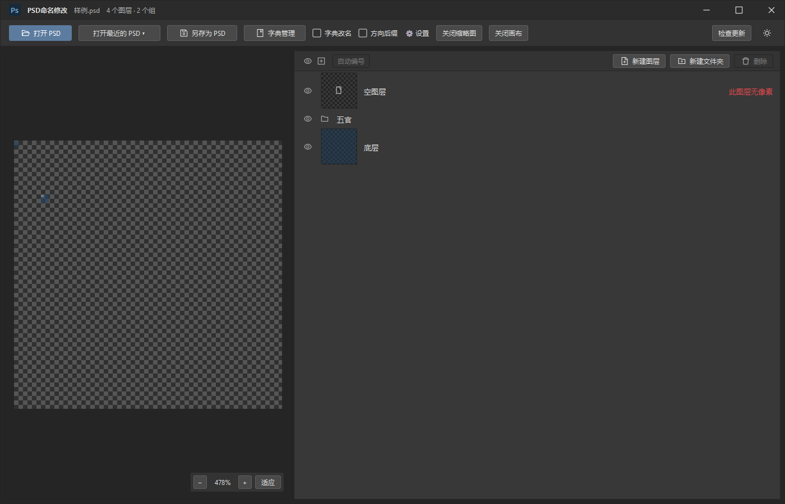

# PSD-Renamer · PSD命名修改

  

**[下载最新版 / Download latest](https://github.com/Miroirkk-arch/PSD-Renamer/releases/latest)** · [v1.1.4 Windows ZIP](https://github.com/Miroirkk-arch/PSD-Renamer/releases/download/v1.1.4/PSDNaming-v1.1.4-win-x64.zip) · [反馈 / Report an issue](https://github.com/Miroirkk-arch/PSD-Renamer/issues/new/choose)

Windows 64 位 · 中文界面 · 无需 Photoshop · 无需安装 Node.js 或 Qt  
Windows x64 · Chinese UI · No Photoshop required · Bundled runtimes

截图使用测试文档。 / Screenshot uses a test document.

快速批量修改 PSD 图层名称的 Windows 桌面工具。支持字典翻译、自定义命名方案、方向后缀和数字／字母编号。

A Windows desktop tool for quickly renaming PSD layers in batches, with editable translation dictionaries, custom naming profiles, direction suffixes, and numeric or alphabetic numbering.

## 中文

### 主要功能

- **批量命名**：内置可编辑的英语字典，支持创建、复制、切换和导入导出自定义方案；重复匹配名称会提示冲突。
- **方向后缀**：自定义屏幕左侧、右侧、中轴的后缀与分割符，分别选择应用到图层或文件夹。
- **自动编号**：数字 `1、2、3` 或字母 `A、B、C`，字母超过 `Z` 后继续 `AA、AB`；保持选择时再次点击可撤销编号。
- **图层管理**：树状列表、Ctrl 多选、Shift 范围选择、新建图层／文件夹、拖拽排序和移动到组、删除图层及空组。
- **预览**：图层缩略图与整体画布，支持画布缩放、显隐切换和调整分栏宽度；可分别关闭缩略图与画布。
- **另存文件**：保存前查看所有改动，默认使用 `原名_1.psd`，不覆盖原文件。
- **界面**：深浅色模式，当前软件界面为中文。

### 下载与打开

在 [最新发布页](https://github.com/Miroirkk-arch/PSD-Renamer/releases/latest) 下载 `PSDNaming-v版本号-win-x64.zip`，解压完整文件夹后打开 `PSD命名修改.exe`。请保留文件夹中的运行依赖，不要只复制 exe。

适用于 Windows 64 位电脑；无需安装或打开 Photoshop，也无需单独安装 Node.js 或 Qt。

### 离线与更新

PSD 读取、修改、预览和保存，以及字典管理，都在本地完成。只有主动点击“检查更新”时才访问 GitHub；不会上传 PSD、字典或本地文件路径。

更新时关闭旧版，将新版 ZIP 解压到新文件夹。个人字典方案和设置保存在用户目录中，更新程序不会覆盖它们。

### 反馈

欢迎在 **Issues** 提交问题或建议。请附上版本号、重现步骤和必要的截图；不要上传包含私人内容的 PSD 文件。

## English

### Features

- **Batch renaming:** an editable built-in English dictionary, multiple custom naming profiles, profile duplication and switching, JSON import/export, and conflict detection for ambiguous matching names.
- **Direction suffixes:** customizable suffixes for the screen's left side, right side, and center, with a custom separator and independent layer/group scope.
- **Automatic numbering:** `1, 2, 3` or `A, B, C`, continuing with `AA, AB` after `Z`. Click again with the same selection to undo numbering.
- **Layer management:** a tree view, Ctrl multi-selection, Shift range selection, new layers and groups, drag-and-drop ordering and regrouping, and deletion of layers or empty groups.
- **Previews:** layer thumbnails and a zoomable canvas, visibility controls, an adjustable divider, and separate switches to hide thumbnails or the canvas.
- **Save as a new file:** review changes before saving; the default name is `original_1.psd`. The source file is kept intact.
- **Appearance:** light and dark modes. The application interface is currently in Chinese.

### Download and run

Download `PSDNaming-vVERSION-win-x64.zip` from the [latest release page](https://github.com/Miroirkk-arch/PSD-Renamer/releases/latest), extract the entire folder, and run `PSD命名修改.exe`. Keep the included runtime files alongside the executable.

For 64-bit Windows. Photoshop is not required, and there is no need to install Node.js or Qt separately.

### Offline use and updates

PSD processing and dictionary management run locally. The app contacts GitHub only when you click **检查更新** (Check for updates). PSD files, dictionaries, and local file paths are not uploaded.

To update, close the old app and extract the new ZIP into a new folder. Personal dictionary profiles and settings are stored in your user profile and are retained across application updates.

### Feedback

Use **Issues** for bug reports and suggestions. Include the app version, steps to reproduce, and relevant screenshots. Please do not upload PSD files containing private material.

## 更多信息 / More information

- [常见问题与反馈 / FAQ & support](SUPPORT.md)
- [版本记录 / Changelog](CHANGELOG.md)
- [第三方组件 / Third-party notices](THIRD_PARTY_NOTICES.md)
- [v1.1.4 SHA256](SHA256SUMS.txt)

本仓库用于发布程序、说明文档和收集反馈；当前不包含应用源码。GitHub 自动生成的 Source code 压缩包仅包含仓库文档，请下载 Releases 附件中的 Windows ZIP。

This repository distributes the app and documentation and collects feedback. Application source code is not included. GitHub’s generated Source code archives contain repository documentation; download the Windows ZIP attached to Releases.
